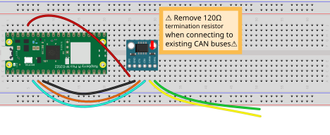
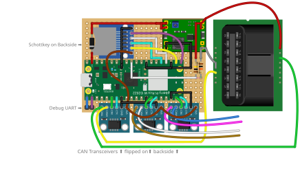
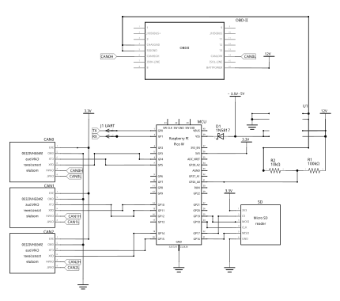

<br />

[](https://github.com/alia5/PiCCANTE/actions/workflows/snapshots.yml)
[](https://github.com/alia5/PiCCANTE/blob/main/LICENSE)
[](https://github.com/alia5/PiCCANTE/releases)
[](https://github.com/alia5/PiCCANTE/issues)
[](https://github.com/alia5/PiCCANTE/pulls)
[](https://discord.gg/hs34MtcHJY)

# PiCCANTE 🌶️

**Pi**CCANTE **C**ar **C**ontroller **A**rea **N**etwork **T**ool for **E**xploration

PiCCANTE is a powerful hacking tool for accessing, exploring, and manipulating vehicle CAN bus networks, built on the affordable Raspberry Pi Pico platform. Designed for researchers, security professionals, and automotive enthusiasts looking to dive deep into vehicle systems without expensive proprietary equipment.

⚠️ **Always exercise caution when connecting to vehicle systems.** ⚠️ 

## ℹ️ About PiCCANTE

PiCCANTE is designed to be a dead-**simple**, dirt-**cheap**, and readily-**available** hardware platform for vehicle research and exploration.  
As cars become more and more computerized, manufacturers keep locking them behind proprietary tools and restrictive systems, even connect vehicles to the internet, yet they still rely on communication standards from the 1980s.  
Car hacking and independent research grows increasingly important to discover security vulnerabilities, reverse engineer vehicle systems, and empower owners with custom tools for diagnostics and tuning that support the Right to Repair movement.

The project leverages Raspberry Pi Pico (2 [W]) development boards, selected for their exceptional affordability, global availability, impressive specifications, and well-documented open-source SDK.

### 🎯 Core Goals

<sub>Keep it D.I.R.T.Y 😉</sub>  

- **D**ead-Simple 🔨  
  - Simple enough for perfboard soldering with minimal components. (Proper PCB available!)
  - No fiddling around with compilers and SDKs: Pre-built firmware releases for immediate use.
- **I**nexpensive 💰  
  - Minimal hardware requirements to keep costs dirt-cheap.  
  - Based on affordable, off-the-shelf components.
- **R**eadily-Available 🌎
  - Fully open-source hardware and software.  
  - Uses widely available Raspberry Pi Pico boards.
- **T**ool-Compatible 🔌
  - Seamless integration with existing CAN tools.  
- **Y**our-First Choice 💡
  - Driverless across all major operating systems.  
  - Easy to use for beginners and experts alike.
  - 🔜 Documentation

### ✨ Features

- ✅ Up to 3× CAN 2.0B interfaces (2× on RP2040 (Pico[W]), 3× on RP2350 (Pico 2[W]))
- ✅ 1× USB-CDC PiCCANTE command + GVRET (binary only) interface
  - Compatible with [SavvyCAN](https://github.com/collin80/SavvyCAN) and other automotive tools
- ✅ Up to 3× USB-CDC SLCAN interfaces (dedicated to each CAN channel)
  - SocketCAN compatible via [can-utils (Linux)](https://github.com/linux-can/can-utils)
- ✅ LED status indicators
- ✅ Command line interface for configuration and diagnostics
- ✅ Auto (Deep) sleep on idle + Wakeup on CAN activity.
- ✅ WiFi support (on Pico W models)
  - ✅ Create WiFi access point (`wifi ap <ssid> <password> <channel>`)
  - ✅ Connect to existing WiFi networks (`wifi connect <ssid> <password>`)
  - ✅ WiFi status and configuration commands
  - ✅ PiCCANTE configuration + GVRET interface as Telnet server
- ✅ Web-based configuration interface (on Pico W models)
  - ✅ Fully responsive on desktop and mobile
  - ✅ Full device configuration
  - ✅ Device Monitoring
  - 🔜 Integrated Web CLI:  
    - 🔜 Live CAN-bus monitoring
    - 🔜 ELM327 commands
  - 🔜 MITM mode configuration
- ✅ Bluetooth support (on Pico W models)
- ☑️ (partial) ELM327 emulator
  - ☑️ Partially implemented AT command set
    - Setup up CAN bus, auto protocol detection and filters (🔜) are missing.  
      Configure the CAN bus beforehand - this is a hacking-tool, you should now your vehicles CAN bus settings.
  - ✅ Support for USB, Bluetooth or WiFi communication
  - ✅ PID request and response
    - ✅ 11bit and 29bit addressing
    - ✅ Multi-Frame PID support (ISO-TP)
    - ✅ Fast mode when number of answered frames is known
  - ✅ Report vehicle battery voltage (if ADC is connected)
  - 🔜 Adaptive Timeouts
- ✅ 3D printable case designs for creating PiCCANTE based OBD-II dongles
- 🔜 Data logging to SD card
- 🔜 MITM mode for advanced analysis / vehicle tuning
- 🔜 (Software) CAN filters

## 🔧 Hardware

For more information, checkout the [hardware](./hardware) directory.

### Simplest version

PiCCANTE is designed to be modular and can be built with just a few components.  
The simplest version just uses a Pico board and a CAN transceiver.

### 🛒 What You'll Need

- 1× Raspberry Pi Pico (any model, RP2040 or RP2350)
  - **Note:** The Pico 2 W (RP2350) is recommended for full feature support, including WiFi and Bluetooth.
- 1-3× CAN transceivers (readily available SN65HVD or any other 3.3V compatible transceiver)
  - **Note:** ⚠️ Most readily available transceiver breakout-boards have a 120 Ohm terminating Resistor on them, when connecting to an existing (terminated) CAN bus this **needs** to be removed. ⚠️
- USB cable

If you want more features, you can add an SD card slot, a buck converter, and other things.

<details>
  <summary>Show Details</summary>
  <br />


</details>

### OBD-II Dongle (DIY Perfboard)

A full PiCCANTE based OBD-II dongle is simple enough to be soldered onto double-sided perfboard.

<details>
  <summary>Show Details</summary>
<br />

A perfboard version fits on a 60mm x 50mm board and the 3D printable case measures just 97mm x 56mm including the OBD-II connector.

It cam be built with the following components (but you can omit anything you don't need):

- Pi Pico (2 [W])
- 3x CAN transceivers (eg. SN65HVD, any 3.3V compatible transceiver will do)
- buck-converter
- SD card slot
- Voltage divider for measuring the vehicle's battery voltage
- Schottky diode for safe dual power supply (1N5817)
- **Case**:
  - ABS/ASA or PETG filament
  - 3x M3 screws
  - 3x M3 heatset inserts
  - 1x male OBD-II connector (I used [this one](https://store.minitools.com/en/components-and-connectors/obd-connectors/sep-a-obd-e2-obd2-male-connector.html))
  - Wires




  


  
  
</details>

### OBD-II Dongle (Manufactured PCB)

A proper PCB with better CAN transceivers can be found in the [hardware directory](./hardware/PiCCANTE-OBD-Dongle/PCB).  
It is made with [KiCAD](https://www.kicad.org/) and can be manufactured by any PCB manufacturer.

<details>
  <summary>Show Details</summary>
    <br />


</details>

## 💾 Software

Pre-compiled binaries for all official Raspberry Pi Pico boards are available as CI action artifacts in the GitHub repository.

When connected via USB, PiCCANTE exposes **up to** 4× USB-CDC interfaces:

- 1× Combined PiCCANTE command + GVRET (binary) interface
  - Always the _first_ exposed CDC device.
  - Also exposed via telnet if enabled on WiFi enabled boards.
- **Up to** 3× SLCAN interfaces (dedicated to each CAN channel)

### 🚀 Basic Usage Examples

#### 🐧 Linux with can-utils (slcan)

```bash
# Set up SLCAN interface
sudo slcand -o -s6 -t hw -S 3000000 /dev/ttyACM1 can0
sudo ip link set up can0

# Monitor CAN traffic
candump can0
```

#### 🖥️ Cross Platform with SavvyCAN

1. Connect PiCCANTE to USB
2. Open SavvyCAN
3. Go to Connection ➡️ Open Connection Window ➡️ Add device Connection
4. Select "Serial Connection (GVRET)" and choose the appropriate COM port / TTY
5. Click "Create New Connection"

### ⌨️ PiCCANTE Commands

```
atz             - Enable ELM mode (if ELM327-Emulator is on USB)
binary          - Toggle GVRET binary mode (binary <on|off>)
can_bitrate     - Change CAN bus bitrate (can_bitrate <bus> <bitrate>)
can_disable     - Disable CAN bus (can_disable <bus>)
can_enable      - Enable CAN bus with specified bitrate (can_enable <bus> <bitrate>)
can_status      - Show status of CAN buses
echo            - Toggle command echo (echo <on|off>)
elm             - Configure ELM327 interface and mode (elm <usb|bt PIN|wifi>  <can0|can1|can2>)
help            - Display this help message
idle_timeout    - Set idle timeout in minutes (idle_timeout disable|<minutes>)
led_mode        - Set LED mode (led_mode <0-3>) 0=OFF, 1=Power, 2=CAN Activity
log_level       - Set log level (log_level <0-3>). 0=DEBUG, 1=INFO, 2=WARNING, 3=ERROR
reset           - Reset the system (reset)
save            - Save current settings to flash
set_num_busses  - Set number of CAN buses (can_num_busses [number])
settings        - Show current system settings
sleep           - Enter deep sleep mode (sleep)
sys_stats       - Display system information and resource usage (sys_stats [cpu|heap|fs|tasks|uptime|adc|wifi])
telnet          - Enable or disable Telnet and set port (telnet enable|disable | telnet <port
version         - Display version information (version)
wifi            - Manage WiFi settings (wifi info | wifi connect <ssid> <password> | wifi ap <ssid> <password> <channel> | wifi disable)
```

## ❓ Frequently Asked Questions

### 🔄 Why only CAN2.0B and not CAN FD/XL?

The Raspberry Pi Pico has no native CAN support. The PIO can2040 implementation we're using only supports CAN 2.0B (due to licensing issues).  
However, if you **need** CAN FD or other bus types, feel free to open a PR supporting a CAN controller (like MCP2518FD).  

### 🔌 Can I use PiCCANTE with Linux/Windows/macOS?

Yes! PiCCANTE is designed to be cross-platform. It works with any operating system as a standard USB device with no special drivers required.  
For SLCAN interfaces, Linux users can use can-utils to provide a SocketCAN interface, while all platforms support the GVRET/SLCAN interface through tools like SavvyCAN.

### 💻 How many CAN buses can I monitor simultaneously?

Up to 3 CAN buses on the RP2350 (Pico 2/2W) and up to 2 CAN buses on the RP2040 (original Pico/Pico W).  
Each bus has a dedicated USB-CDC SLCAN interface.

### 🔧 Why build my own instead of buying a commercial CAN adapter?

PiCCANTE gives you a fully open-source solution at a fraction of the cost of commercial tools.  
You get complete control over the hardware and software, the ability to customize for specific needs, and valuable learning experience about CAN networks and embedded systems.

## ❓ Troubleshooting

- **Issue**: CAN bus not receiving data  
  *Solutions*:  
  - Verify CAN status with `can_status` command
  - Verify wiring and bitrate settings
  - Check for proper bus termination resistance (remove resistor on the transceiver if connected to an existing CAN-bus)

- **Issue**: LED not lighting up / blinking  
  *Solutions*:
  - Check USB connection and power
  - Check led_mode command on the first USB CDC device

## 🛠️ Development

PiCCANTE is built using the Raspberry Pi Pico SDK and follows standard Pico development practices. This section covers how to set up your development environment, build the project, and extend its functionality.

### 🧰 Prerequisites

- [Raspberry Pi Pico SDK](https://github.com/raspberrypi/pico-sdk)
- [CMake](https://cmake.org/) (3.13 or newer) [Windows: bundled with PicoSDK]
- C/C++ compiler (GCC ARM) [Windows: bundled with PicoSDK]
- [Visual Studio Code](https://code.visualstudio.com/) with the [Pico extension]([https://marketplace.visualstudio.com/items?itemName=marus25.cortex-debug](https://marketplace.visualstudio.com/items?itemName=raspberry-pi.raspberry-pi-pico)) (recommended)

### 🔄 Environment Setup

1. **Install the Pico SDK**:

    Follow the instructions in the [Pico SDK documentation](https://github.com/raspberrypi/pico-sdk) to install the SDK

2. **Clone PiCCANTE**:

    ```bash
    git clone git@github.com:Alia5/PiCCANTE.git
    cd PiCCANTE
    git submodule update --init --recursive
    ```

### 🏗️ Building

#### 💻 Command Line

1. **Configure with CMake**:

   ```bash
   cmake -B build -G Ninja -DCMAKE_BUILD_TYPE=Release
   ```

2. **Build the project**:

   ```bash
   cmake --build build --config Release
   ```

#### 🖥️ Using VS Code

1. Open the PiCCANTE folder in VS Code
2. Press F1 and select "CMake: Configure"
3. Press F7 to build the project
4. To flash, connect a Pico in BOOTSEL mode and press F5

## 👥 Contributing

Contributions to PiCCANTE are welcome! Whether it's bug reports, feature requests, documentation improvements, or code contributions, your help makes this project better.

- **Bug Reports**: Open an issue describing the problem and steps to reproduce it
- **Feature Requests**: Open an issue describing the desired functionality
- **Code Contributions**: Fork the repository, make your changes, and submit a pull request

### Extending PiCCANTE

PiCCANTE is designed to be extensible. Here are some key areas where you might want to extend functionality:

- **Adding new commands**: Extend the command interpreter to add custom commands.
- **Implementing new protocols**: Add new protocol handlers in their respective directories.
- **Car-specific tools**: Fork PiCCANTE to create a car-specific tool and diagnostics dongle.
- **Custom gauges**: Fork PiCCANTE and use it as a base controller to implement custom gauges.
- **Custom data logging**: Implement custom data logging to SD card to monitor your vehicle on a track day.

## 📄 License

```
PiCCANTE - PiCCANTE Car Controller Area Network Tool for Exploration
Copyright (C) 2025 Peter Repukat

This program is free software: you can redistribute it and/or modify
it under the terms of the GNU General Public License as published by
the Free Software Foundation, either version 3 of the License, or
(at your option) any later version.

This program is distributed in the hope that it will be useful,
but WITHOUT ANY WARRANTY; without even the implied warranty of
MERCHANTABILITY or FITNESS FOR A PARTICULAR PURPOSE.  See the
GNU General Public License for more details.

You should have received a copy of the GNU General Public License
along with this program.  If not, see <https://www.gnu.org/licenses/>.
```
